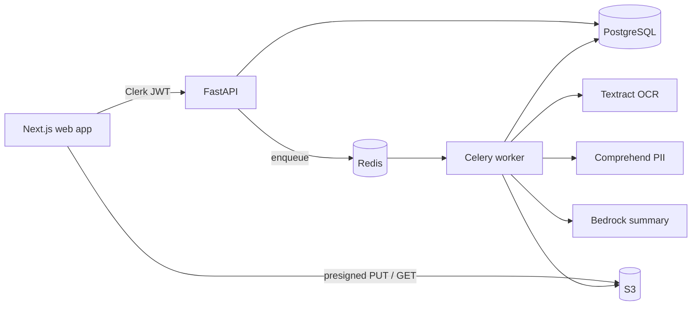

# RedacTLDR

Upload a sensitive PDF, find the personal information in it, black it out for real, and get a short AI summary that never sees the private details.

## In plain terms

People share documents that contain things they should not: a resume with a home address and phone number, a medical form with a date of birth, a contract with account numbers. Blacking out text with a drawing tool usually only hides it; the words are still in the file and can be copied out.

RedacTLDR handles the whole job:

1. **Upload** a PDF, including scanned pages.
2. **Find** names, emails, phone numbers, addresses, ID numbers, and other personal details automatically.
3. **Review** each finding on top of the page, turn items on or off, and draw extra boxes by hand.
4. **Export** a new PDF where the selected text and images are permanently removed. The file is checked before you can download it, and the export fails instead of handing back anything that still contains a removed value.
5. **Summarize** the document with AI. Private values are swapped for placeholders before the AI sees the text, and a summary that repeats one is thrown away.

There are five modes (resume, employment paperwork, medical paperwork, legal contract, terms and conditions). Each mode decides what is removed by default and what the summary focuses on.

## Technical overview

| Layer | Stack |
|---|---|
| Web | Next.js 15 (App Router), React 19, TypeScript, Tailwind, Radix UI, TanStack Query, Zustand, react-pdf |
| Auth | Clerk; the API verifies RS256 JWTs against Clerk's JWKS with audience and issuer checks |
| API | FastAPI, SQLAlchemy 2, Alembic, Pydantic, PostgreSQL |
| Background jobs | Celery workers and beat on Redis |
| Document AI | AWS Textract (OCR), Amazon Comprehend plus custom regex rules (PII), PyMuPDF (redaction), LangChain with Amazon Bedrock (summaries) |
| Storage | S3 via short-lived presigned URLs; the browser uploads and downloads directly |
| Infrastructure | Terraform modules for VPC, ALB, ECS Fargate, ElastiCache, KMS-encrypted S3, Secrets Manager, IAM with GitHub OIDC, CloudWatch alarms |
| Observability | OpenTelemetry traces carried from the API request into the worker, exported to X-Ray; JSON logs with trace and document IDs |
| CI/CD | GitHub Actions: tests, lint, typecheck, build, Playwright smoke, Docker builds, Trivy and SBOM, pip-audit, npm audit, gitleaks, OIDC deploy to ECS |



### How a document moves through the system

1. The API creates the document row and returns a presigned S3 upload URL. The file never passes through the API.
2. After upload, a `process_document` job runs Textract and stores word-level boxes as JSON in S3.
3. Detection combines Comprehend results with custom rules, merges overlaps, maps every finding to boxes on the page, and applies the mode's policy (remove automatically, suggest, or ignore). Postgres stores masked values by default, not the raw text.
4. The review screen draws those boxes over the rendered PDF. Edits save optimistically, and each one is written to the audit log.
5. Export removes text and image pixels under every selected box, strips metadata, links, attachments, JavaScript, and hidden text layers, then verifies that no character sits inside a box and no selected value remains anywhere in the file. A failed check produces no file.
6. Summaries tokenize the selected values first, run one structured schema per mode (long documents are chunked and merged), and reject output that leaks a removed value.

### Security and privacy

- Every document query is scoped to the signed-in user; sub-resources (detections, boxes, exports) must belong to that document.
- Clerk JWTs are verified with a pinned algorithm, audience, and issuer. The local `x-demo-user` shortcut works only when `ENVIRONMENT=local`.
- Presigned links expire in minutes. Buckets use SSE-KMS and lifecycle rules in the Terraform environment.
- Logs pass through a redaction filter and record counts, not values.
- Per-user rate limits and page caps on expensive jobs, shared through Redis.
- A user can delete all of their data; old documents are purged on a retention schedule.
- Containers run as a non-root user. The Redis broker uses TLS in AWS.

## Repository layout

```
apps/web/            Next.js app (dashboard, review editor, summaries, settings, activity)
services/api/        FastAPI app, routes, models, tests
services/worker/     Celery tasks: OCR, detection, redaction, summaries, retention, tests
services/shared/     Code used by both: mode policies, summary schema, log redaction, tracing
alembic/             Database migrations
ops/compose/         Local Docker Compose stack
ops/docker/          API and worker images
ops/k8s/             Optional Helm chart (ECS is the primary target)
infra/terraform/     AWS infrastructure and the deploy runbook
frontend/mobile/     Early Expo mobile client, paused while the web app is the focus
scripts/             Local start/stop and AWS helper scripts
```

## Running it locally

Requirements: Docker Desktop. AWS credentials with access to S3, Textract, Comprehend, and Bedrock are needed for real document processing. Clerk keys are optional.

```bash
bash scripts/up.sh          # first run copies ops/compose/.env.example to ops/compose/.env
```

- Web: http://localhost:3000
- API health: http://localhost:8000/v1/health

Without Clerk keys the app runs in a local demo mode with no sign-in. Add Clerk keys to `ops/compose/.env` for the full sign-in flow. If browser uploads fail with an S3 CORS error, run `bash scripts/apply-s3-cors.sh`; `bash scripts/verify-local-s3.sh` checks that the credentials can reach the buckets.

```bash
bash scripts/down.sh        # stop; add -v to also remove the local database volume
```

## Tests

```bash
pip install -r requirements.txt && pytest     # API and worker (needs Postgres on localhost:5432)
npm install
npm run web:lint && npm run web:typecheck && npm run web:build
```

The Python suite covers the pipeline end to end with mocked AWS (moto), detection rules and merging, the policy engine, redaction and its verification, summary leak checks, log redaction, and JWT verification. CI runs all of it on every push and pull request.

## Status

Working end to end on the local stack against real AWS services: upload, OCR, PII detection, true-redaction export, and safe-mode summaries. The review editor, notifications, settings, activity history, and delete-all-data are built and covered by tests.

The Terraform environment and the deploy workflow are written and validated but not yet applied. The deploy job stays off until the AWS role is configured.
