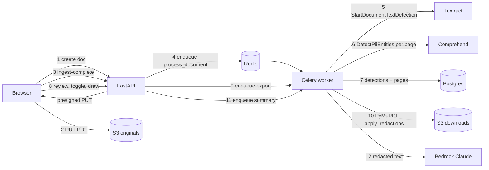

# RedacTLDR — Road to Full Implementation (Master Workflow)

This is the **master execution document**. It compresses the 18 milestones in
`docs/EXECUTION_PLAN.md` / `docs/MILESTONES_DETAILED.md` into **10 phases (R0–R9)**
with a faster path to a finished, polished product. The old docs stay as reference
for rationale and interview talking points; **this file decides what gets built next
and in what order.**

How to use it:

- Work one phase at a time, top to bottom. Each phase is sized for 1–3 agent sessions.
- Start a session with: `Execute phase RX from docs/ROAD_FULL_IMPLEMENTATION.md`.
- A phase is done only when every box under **Done when** is checked and the
  **Validation** commands pass. Then tick the phase in the tracker below and update
  `docs/MILESTONE_STATUS.json`.
- **Keep this file current.** Whenever a phase from this roadmap is implemented,
  update this document in the same change: check the **Done when** boxes that
  actually passed, set the tracker status, and edit the phase text if the
  implementation differed from the plan. This file stays the source of truth
  for what gets built next.

---

## 0. Product Definition (what "fully implemented" means)

A signed-in user can:

1. Drag a PDF (digital or scanned) into a polished dashboard and pick a mode
   (resume, employment, medical, legal contract, terms & conditions).
2. Watch live progress: uploading → reading document (OCR) → finding sensitive info → ready.
3. Open a review screen showing the PDF with highlighted sensitive items, grouped by type,
   toggle each one on/off, bulk-toggle by type, and draw manual redaction boxes.
4. Export a **truly redacted PDF** (text removed, not just covered; metadata scrubbed) and
   download it.
5. Generate a mode-specific AI summary (e.g. resume skills/experience, contract obligations
   and risks) that is built from the **redacted** text when safe mode is on.
6. See notifications, activity history, and manage settings (default mode, safe mode,
   OCR retention, delete document/account data).
7. Use all of this on a deployed HTTPS site, not only localhost.

---

## 1. Phase Tracker

| Phase | Name | Replaces old milestones | Status |
|------|------|--------------------------|--------|
| R0 | Stabilize + close Gate B | M4, M5 | ◐ |
| R1 | Design system + app shell (UI foundation) | M2 polish, M12 (part) | ☐ |
| R2 | Real OCR pipeline (Textract) | M6 | ☐ |
| R3 | PII detection + policy engine | M7, M8 | ☐ |
| R4 | Review UI with overlays | M9 | ☐ |
| R5 | True redaction export | M10 | ☐ |
| R6 | AI summaries (LangChain + Bedrock) | M11 | ☐ |
| R7 | Polish, notifications, security hardening | M12, M13 | ☐ |
| R8 | Production deploy + CI/CD + observability | M14, M15, M16, M17 | ☐ |
| R9 | Optional Kubernetes path | M18 | ☐ (optional) |

Critical path: **R0 → R2 → R3 → R4 → R5** is the core product. R1 can run in parallel
with R2 (different files). R6 needs R3. R8 can start any time after R5.

---

## 2. Final Tech Stack

| Layer | Technology | Notes |
|------|------------|-------|
| Web | Next.js 15 (App Router), React 19, TypeScript | existing `apps/web` |
| Styling | Tailwind CSS 3, shadcn/ui (Radix primitives), lucide-react icons, Geist font | added in R1 |
| Web state | TanStack Query (server state), Zustand (review editor state) | both already installed |
| Web UX libs | `sonner` (toasts), `react-dropzone` (upload), `react-pdf` / pdf.js (viewer) | R1, R4 |
| Auth | Clerk (`@clerk/nextjs`) + JWT template `redactldr-api` | existing |
| API | FastAPI, Pydantic v2, SQLAlchemy 2, Alembic | existing `services/api` |
| Queue | Celery 5 + Redis 7 | queue name `default` |
| Worker | Python 3.11, boto3, PyMuPDF (`pymupdf`), `langchain-aws` | `services/worker` |
| Database | Postgres 16 locally, Supabase Postgres in cloud | RLS deny-by-default already in place |
| Storage | S3 originals + downloads buckets, SSE-KMS (R7) | presigned PUT/GET |
| OCR | Amazon Textract (async text detection for multi-page PDFs) | R2 |
| PII | Amazon Comprehend `DetectPiiEntities` + custom regex rules | R3 |
| LLM | Amazon Bedrock (Claude) via `ChatBedrockConverse` + structured output | R6 |
| Email (optional) | Resend or Amazon SES | R7 |
| Observability | OpenTelemetry SDK → collector → CloudWatch/X-Ray (or Grafana Cloud) | R8 |
| Infra | Terraform (S3, KMS, IAM, ECR, ECS Fargate, ALB, ElastiCache, Secrets Manager, CloudWatch) | R8 |
| Web hosting | Vercel (fastest path) — ECS alternative documented | R8 |
| CI/CD | GitHub Actions + AWS OIDC role, ECR push, migrations task, ECS deploy | R8 |
| Tests | pytest, moto (S3), recorded AWS fixtures, Playwright (web E2E) | throughout |

---

## 3. Target Data Flow



### Document lifecycle (final)

```
CREATED → UPLOADED → PROCESSING (stage: ocr | detect) → READY_FOR_REVIEW
READY_FOR_REVIEW → EXPORT_QUEUED → EXPORTED
READY_FOR_REVIEW / EXPORTED → SUMMARY_QUEUED → SUMMARIZED
any → FAILED (error_code + error_message, retryable via POST /process)
```

`DETECT_QUEUED` and `DETECTED` stay valid for old rows; R2 adds a migration that maps
`DETECTED → READY_FOR_REVIEW` and `DETECT_QUEUED → PROCESSING`.

---

## 4. What Omer Needs to Provide

Put secrets **directly into `ops/compose/.env`** (gitignored). Do not paste secret values
into chat; just say "done" for each item.

### Needed before R0/R2 (now)

| # | Item | Status | Why | How |
|---|------|--------|-----|-----|
| 1 | **Dedicated IAM user access key for the app** (`redactldr-dev-app`) | Done | Session tokens from `aws login` expire every few hours and caused the 400 upload errors | IAM → Users → Create `redactldr-dev-app` → attach the inline policy in §4.1 → Security credentials → Create access key (type "Application running outside AWS"). Put `AWS_ACCESS_KEY_ID` + `AWS_SECRET_ACCESS_KEY` in `.env` and **delete** `AWS_SESSION_TOKEN` and `AWS_CREDENTIAL_EXPIRATION` lines |
| 2 | **Confirm region `us-east-1`** | Done | Textract, Comprehend, and Bedrock must run in the same region as the S3 buckets | Just confirm |
| 3 | **AWS Budget alert** | Done | Textract/Comprehend/Bedrock are pay-per-use | Billing → Budgets → monthly cost budget $25 with email alert at 80% |
| 4 | **Supabase decision** | Done | The pooler currently rejects the connection (`tenant/user ... not found`) — project is likely paused or deleted | Either (a) restore the project and paste fresh **Transaction pooler** (port 6543) and **Direct** connection strings into `DATABASE_URL` / `MIGRATION_DATABASE_URL`, or (b) say "local Postgres until deploy" |
| 5 | **3–5 test PDFs with fake data** | Done | Needed to validate OCR, detection, and redaction | One digital resume, one scanned (image-only) page, one multi-page contract, one form with SSN/phone/address. Drop them in `samples/` (gitignored) |

### Needed before R6 (AI summaries)

| # | Item | Status | How |
|---|------|--------|-----|
| 6 | **Bedrock model access for Claude** | Done | Bedrock console → Model access → enable Anthropic Claude models (fill the Anthropic use-case form if asked). Tell me the **model/inference profile ID** you have (e.g. one starting with `us.anthropic.claude-`), and put it in `BEDROCK_MODEL_ID` |

### Needed before R7/R8 (production)

| # | Item | Status | How |
|---|------|--------|-----|
| 7 | **Domain name** | Not yet | Any registrar. Tell me the domain and whether DNS is on Route 53 |
| 8 | **Hosting choice for web** | Done | Recommended: Vercel (free tier, native Next.js). Alternative: ECS (all-AWS) |
| 9 | **Clerk production instance** | Not yet | Clerk dashboard → create production instance for the domain → recreate JWT template `redactldr-api` (audience `redactldr-api`) → give prod publishable/secret keys (into deploy secrets, not `.env`) |
| 10 | **GitHub Actions permission** | Done for workflow files. OIDC role is still later | Allow me to add workflow files and tell me when you've created the AWS OIDC role (I'll write the Terraform for it) |
| 11 | **Email provider (optional)** | Done — skipped | Resend API key + verified sending domain, or skip email notifications |
| 12 | **Decision: PyMuPDF license** | Done — AGPL OK | PyMuPDF is AGPL-3.0. Fine for a personal/portfolio project; a commercial product needs a license or a different engine. Say "AGPL OK" or "avoid AGPL" |
| 13 | **Brand preferences (optional)** | Done — default look | Primary color, logo, tone. If none, I'll use a clean dark-navy/emerald "privacy tool" look |

### 4.1 IAM policy for `redactldr-dev-app`

```json
{
  "Version": "2012-10-17",
  "Statement": [
    {
      "Sid": "DocumentBuckets",
      "Effect": "Allow",
      "Action": ["s3:PutObject", "s3:GetObject", "s3:DeleteObject"],
      "Resource": [
        "arn:aws:s3:::redactldr-originals-dev/*",
        "arn:aws:s3:::redactldr-downloads-dev/*"
      ]
    },
    {
      "Sid": "ListBuckets",
      "Effect": "Allow",
      "Action": ["s3:ListBucket"],
      "Resource": [
        "arn:aws:s3:::redactldr-originals-dev",
        "arn:aws:s3:::redactldr-downloads-dev"
      ]
    },
    {
      "Sid": "Textract",
      "Effect": "Allow",
      "Action": [
        "textract:DetectDocumentText",
        "textract:StartDocumentTextDetection",
        "textract:GetDocumentTextDetection"
      ],
      "Resource": "*"
    },
    {
      "Sid": "Comprehend",
      "Effect": "Allow",
      "Action": ["comprehend:DetectPiiEntities", "comprehend:DetectDominantLanguage"],
      "Resource": "*"
    },
    {
      "Sid": "Bedrock",
      "Effect": "Allow",
      "Action": ["bedrock:InvokeModel", "bedrock:InvokeModelWithResponseStream"],
      "Resource": "*"
    }
  ]
}
```

In R7 the S3 statements gain `kms:GenerateDataKey` / `kms:Decrypt` on the RedacTLDR KMS key,
and in R8 the same permissions move to ECS task roles (no static keys in production).

### 4.2 Decisions locked (2026-09-30)

These are accepted. Do not re-ask unless Omer changes them.

| Item | Decision |
|------|----------|
| Region | `us-east-1` |
| Database | Restored Supabase project. Runtime uses the transaction pooler; migrations use the direct host. |
| AWS credentials | Long-lived `redactldr-dev-app` access key in `ops/compose/.env`. No session token. |
| Budget | Monthly cost budget is in place. |
| Bedrock model | `BEDROCK_MODEL_ID=us.anthropic.claude-haiku-4-5-20251001-v1:0` |
| Web hosting (R8) | Vercel |
| Email (R7) | Skip. In-app notifications only until an email provider is requested. |
| PyMuPDF | AGPL-3.0 is OK for this personal/portfolio project. |
| Brand | Dark navy and emerald privacy-tool look. No custom logo. |
| GitHub Actions (R8) | Workflow files may be added when R8 starts. |

Still waiting on Omer, and only at production time: a domain name, whether DNS is on Route 53, a Clerk production instance, and creating the AWS OIDC deploy role from the Terraform written in R8.

---

## R0 — Stabilize + Close Gate B

**Goal:** the current upload → queue → worker path is reliable, tested, and documented.
**Replaces:** M4, M5. **Estimate:** 1 session.

### Build

- Housekeeping
  - Commit the large pile of uncommitted work in logical commits (infra, api, worker, web, docs).
  - Rebuild API image so the Celery `default` queue fix is baked in; worker listens on
    `default,celery` for backlog safety.
  - `scripts/dev-up.sh` auto-detects busy ports (5432/8000) and applies
    `ops/compose/docker-compose.local-ports.yml`, printing the actual URLs.
  - Switch `.env` to the long-lived IAM user key (item 1) and remove session-token handling
    from the default path (keep `scripts/sync-aws-env.sh` as fallback).
- API
  - `GET /v1/documents/{id}/jobs` → list of `{jobType, status, attemptCount, lastError, startedAt, finishedAt}`.
  - `POST /v1/documents/{id}/process` → re-run pipeline for `FAILED` or stuck docs (idempotent).
  - `DELETE /v1/documents/{id}` → soft delete row + delete S3 objects.
  - Stale-upload cleanup: documents stuck in `CREATED` > 24h are soft-deleted by a Celery beat task.
- Worker
  - All raw SQL parameters explicitly cast (fix class of the `AmbiguousParameter` bug).
  - Task idempotency: skip work if the document is already past the stage.
- Tests
  - pytest integration test: create → (moto S3 put) → ingest-complete → run task eagerly → `DETECTED`.
  - Failure test: task raises → retries → `FAILED` job row with `last_error`.
- Docs: `docs/M4_M5_VALIDATION_PLAYBOOK.md`; update `IMPLEMENTATION_STATUS.md` + `MILESTONE_STATUS.json` (M4, M5 → completed).

### Done when

- [ ] Browser upload works after a full restart with no manual credential syncing.
- [x] Uploaded document reaches the terminal status and job row is `COMPLETED`.
      Covered by `services/api/tests/test_document_pipeline.py` (eager worker, moto S3).
- [x] Failed document can be retried from API. Same test module (`POST /process`).
- [x] `pytest services/api/tests services/worker/tests` passes, including new integration tests.
      Last run: 12 passed (2026-09-30).

R0 code is in. The tracker stays **◐** until the browser restart check above is done.
`scripts/dev-up.sh` no longer overwrites IAM keys, and it falls back to
`docker-compose.local-ports.yml` when 5432 or 8000 is busy. Live image rebuild
and a browser upload after `bash scripts/dev-up.sh --build` were not re-run in
the session that landed this code.

### Validation

```bash
bash scripts/dev-up.sh --build
bash scripts/verify-local-s3.sh
pytest services/api/tests services/worker/tests
curl -s localhost:8000/v1/documents/<id>/jobs -H "x-demo-user: demo-user"
```

---

## R1 — Design System + App Shell

**Goal:** the product looks and feels finished before deeper features land on top of it.
**Replaces:** M2 polish, part of M12. **Estimate:** 1–2 sessions. Can run parallel to R2.

### Build

- Foundation
  - Install and configure shadcn/ui (Button, Card, Badge, Dialog, DropdownMenu, Tabs,
    Tooltip, Progress, Skeleton, Sheet, Switch, Select, Table, Separator, ScrollArea).
  - Design tokens in `globals.css` (CSS variables for light/dark), Geist Sans/Mono via `next/font`,
    `next-themes` dark mode toggle.
  - `sonner` toasts wired into React Query mutation errors/success.
- Pages and layout
  - `/` landing page: hero ("Share documents without sharing yourself"), how-it-works
    (upload → review → export), mode cards, privacy promises, CTA to sign in.
  - App shell for signed-in routes: left sidebar (Documents, Activity, Settings), top bar
    with Clerk `UserButton`, responsive mobile sheet menu.
  - `/dashboard`: stats row (documents, ready for review, exported), document table/cards
    with filename, mode badge, status badge, pages, updated time, row actions
    (Open, Retry, Delete), empty state illustration, skeleton loading.
  - Upload panel: `react-dropzone` drag area, mode picker as selectable cards with icons and
    one-line descriptions, safe mode switch with tooltip, **real upload progress** using
    `XMLHttpRequest.upload.onprogress` (fetch has no upload progress), multi-file queue.
  - `/documents/[id]`: overview page with status timeline (Uploaded → Reading → Detecting →
    Ready), page count, entity counts, buttons to Review / Export / Summarize.
  - Global error boundary, `not-found`, and friendly API error messages.
- Code structure
  - `apps/web/components/ui/*` (shadcn), `components/app-shell/*`, `components/documents/*`.
  - `lib/api.ts` split into typed resource modules (`lib/api/documents.ts`, etc.).
  - Status → label/color/icon map in one place (`lib/status.ts`).

### Done when

- [ ] Landing, dashboard, and document overview pages look polished on desktop and mobile widths.
- [ ] Upload shows a real percentage bar and toasts on success/failure.
- [ ] Dark mode works everywhere.
- [ ] `npm run web:lint && npm run web:typecheck && npm run web:build` pass.

---

## R2 — Real OCR Pipeline (Textract)

**Goal:** every uploaded PDF produces real text with page geometry.
**Replaces:** M6. **Estimate:** 1–2 sessions.

### Build

- Data (Alembic migration)
  - `documents`: add `page_count int`, `processing_stage varchar`, `error_code varchar`,
    `error_message text`, `textract_job_id varchar`, `ocr_s3_key varchar`.
  - New table `document_pages`: `id, document_id, page_number, width, height, word_count,
    has_text_layer bool`.
  - Status values: add `PROCESSING`, `READY_FOR_REVIEW`; migrate old values (see §3).
- Worker (`services/worker/app/ocr.py`)
  - Single orchestrating task `process_document(document_id)` that runs stages with
    idempotency: `ocr` → `detect` → set `READY_FOR_REVIEW`. API enqueues this instead of `detect_job`.
  - OCR stage: `textract.start_document_text_detection(DocumentLocation=S3Object)`,
    poll `get_document_text_detection` with exponential backoff (2s → 10s, max ~10 min),
    follow `NextToken` pagination, collect `PAGE`/`LINE`/`WORD` blocks.
  - Normalize into an internal model: pages → lines → words, each with text and
    normalized bbox `{x, y, width, height}` (Textract `BoundingBox` is already 0–1).
  - Store the normalized OCR JSON in S3 at `ocr/{user}/{doc}.json` (never in logs; optional
    DB storage is off by default = privacy policy "OCR retention").
  - Use PyMuPDF to read page sizes and detect whether pages have a native text layer
    (useful later for export and for skipping Textract on digital PDFs as a cost optimization).
- API
  - `GET /v1/documents/{id}` returns `pageCount`, `processingStage`, `errorMessage`.
  - `GET /v1/documents/{id}/original-url` → short-lived presigned GET for the viewer.
  - `GET /v1/documents/{id}/pages` → page sizes (no text).
- Tests
  - Recorded Textract response fixture (`tests/fixtures/textract_*.json`) → parser unit tests.
  - Stage idempotency test (re-running does not call Textract twice).
- Web: dashboard timeline shows "Reading document (OCR)" stage live.

### Done when

- [ ] Digital and scanned sample PDFs both produce OCR JSON with correct page count.
- [ ] Multi-page PDF works (pagination handled).
- [ ] Failures (unsupported/corrupt PDF, Textract error) set `FAILED` with a readable message.

### Validation

```bash
pytest services/worker/tests -k ocr
# upload samples/scanned.pdf in the UI, then:
aws s3 ls s3://redactldr-originals-dev/ocr/ --recursive
```

---

## R3 — PII Detection + Policy Engine

**Goal:** real sensitive entities, positioned on the page, filtered by mode policy.
**Replaces:** M7, M8. **Estimate:** 2 sessions.

### Build

- Detection engine (`services/worker/app/detection/`)
  - Build page text from OCR lines (`"\n"` between lines, `" "` between words) while recording
    each word's `(start, end)` character span.
  - Comprehend `detect_pii_entities(Text, LanguageCode="en")` per page, chunking under the
    100 KB request limit at line boundaries and re-offsetting results.
  - Custom rules (`rules.py`) for things Comprehend misses or modes need: LinkedIn/GitHub URLs,
    student IDs, medical record numbers (MRN), policy numbers, graduation years, addresses
    split across lines. Each rule returns `(start, end, type, confidence)`.
  - Merge + dedupe overlapping spans (prefer higher confidence, keep union range).
  - Span → geometry: find words overlapping the span, group by line, union each line's word
    boxes → one or more bboxes per detection (multi-line entities get multiple rects).
- Policy engine (`services/worker/app/policy.py`, shared contract in API)
  - Per-mode config: which entity types are **auto-accepted**, **suggested** (shown but off),
    or **ignored**. Example: resume mode auto-redacts NAME, EMAIL, PHONE, ADDRESS, URL,
    AGE/DOB; suggests DATE_TIME and organization names; ignores skills.
  - Minimum confidence per type; safe mode lowers thresholds and auto-accepts suggestions.
  - `GET /v1/policies/modes` returns the policy for the UI (labels, colors, descriptions).
- Data (migration)
  - `detections`: add `rects jsonb` (list of bboxes), `char_start`, `char_end`,
    `masked_text varchar`, `policy_action varchar` (`auto|suggested`), `rule_id varchar`.
  - `detected_text` stores **masked** text by default (`j***@g***.com`); raw text is never
    stored unless user setting `store_raw_detections` is on.
- API
  - `GET /v1/documents/{id}/detections?page=` with grouping metadata.
  - `PATCH /v1/documents/{id}/detections/{detectionId}` `{accepted}`.
  - `POST /v1/documents/{id}/detections/bulk` `{entityType, accepted}`.
- Tests: span-mapping unit tests (single word, multi-word, multi-line), policy tests per mode,
  Comprehend fixture tests, merge/dedupe tests.

### Done when

- [ ] Sample resume: name, email, phone, address, links detected with correct boxes.
- [ ] Each mode yields different default accepted sets.
- [ ] No raw PII in logs or DB by default (grep test in CI).

---

## R4 — Review UI with Redaction Overlays

**Goal:** the core "wow" screen — review and edit redactions on the real PDF.
**Replaces:** M9. **Estimate:** 2 sessions.

### Build

- Route `/documents/[id]/review`, three-panel layout:
  - Left: page thumbnails with per-page entity count dots.
  - Center: `react-pdf` page render from presigned original URL, zoom (fit width / 100% / 150%),
    page navigation, overlay layer with absolutely positioned boxes from normalized rects.
    Accepted = solid black with type label on hover; suggested = dashed colored outline;
    rejected = hidden (toggle "show rejected").
  - Right: entity list grouped by type (collapsible), counts, per-item toggle, per-type
    bulk toggle, click item → scroll/flash its box, search filter.
- Manual redactions
  - "Draw" tool: click-drag rectangle on a page → creates manual redaction; select, resize,
    delete; keyboard shortcuts (`D` draw, `Delete` remove, `←/→` pages, `A` accept all of type).
  - API: `POST /v1/documents/{id}/redactions` (exists, extend), `PATCH .../redactions/{rid}`,
    `DELETE .../redactions/{rid}`.
- State: Zustand store for editor (selected item, tool, zoom); TanStack Query optimistic
  mutations with rollback; debounced saves; "All changes saved" indicator.
- Top bar: document name, mode badge, "X items will be redacted", primary button
  **Export redacted PDF**, secondary **Generate summary**.
- `GET /v1/documents/{id}/review-state` returns everything the screen needs in one call
  (already exists; extend with rects, policy action, page sizes).

### Done when

- [ ] Boxes align with the text at every zoom level on digital and scanned samples.
- [ ] Toggles, bulk toggles, and manual boxes persist across reload.
- [ ] Usable on a laptop screen; tablet width degrades to tabs (Pages / Viewer / Items).

---

## R5 — True Redaction Export

**Goal:** exported PDF has the content **actually removed**.
**Replaces:** M10. **Estimate:** 1 session.

### Build

- Worker `export_job` rewrite (`services/worker/app/redaction.py`)
  - Download original from S3; collect accepted detections + active manual redactions.
  - For each rect: convert normalized → PDF points using the page's `rect`
    (handle page rotation), `page.add_redact_annot(rect, fill=(0, 0, 0))`.
  - `page.apply_redactions(images=pymupdf.PDF_REDACT_IMAGE_PIXELS)` so text **and** image pixels
    (scanned pages) under the box are removed.
  - Scrub metadata (`doc.set_metadata({})`, remove XMP), drop annotations/attachments/JS,
    save with `garbage=4, deflate=True`.
  - Upload to downloads bucket `exports/{user}/{doc}/{exportId}.pdf`; record in `exports`.
- Verification step (mandatory, runs in the task)
  - Re-open output, extract text per page, assert none of the redacted spans' original text
    (re-derived from OCR JSON in memory) appears. If it does → export `FAILED`, never served.
- API: export endpoints exist; add `GET /v1/documents/{id}/exports` history.
- Web: export dialog (options: include redaction labels yes/no), progress state, download button,
  export history list on document page.
- Tests: golden-file tests on sample PDFs (digital + scanned), metadata-scrub test,
  "copy-paste leak" regression test.

### Done when

- [ ] Downloaded PDF: selecting/copying/searching redacted areas returns nothing.
- [ ] `pdftotext exported.pdf -` shows no redacted values.
- [ ] Scanned-page redactions remove pixels, not just overlay them.

---

## R6 — AI Summaries (LangChain + Bedrock)

**Goal:** structured, mode-specific summaries that respect privacy.
**Replaces:** M11. **Estimate:** 1–2 sessions. **Needs:** item 6 (Bedrock access).

### Build

- Worker (`services/worker/app/summary/`)
  - Input text = OCR text with accepted redactions replaced by typed tokens (`[NAME]`, `[EMAIL]`)
    when safe mode is on; raw text only when safe mode is off.
  - `ChatBedrockConverse(model=BEDROCK_MODEL_ID).with_structured_output(<ModePydanticModel>)`.
  - One Pydantic schema per mode, e.g.:
    - resume: skills, years_experience, roles[], education[], highlights[]
    - employment: compensation, start_date, benefits[], obligations[], red_flags[]
    - medical: visit_summary, medications[], follow_ups[], what_to_share[]
    - legal contract: parties (tokenized), term, payment, termination, liabilities, risks[]
    - terms & conditions: data_collected[], data_sharing[], cancellation, gotchas[]
  - Every field includes page citations (`[{page, quote_snippet}]` — snippets also tokenized).
  - Long docs: map (per ~6 pages chunk → partial structured output) → reduce (merge).
  - Record token usage and model id in `summaries.token_usage`; cap max pages/tokens per doc.
- API: summary endpoints exist; return typed payload + `schemaVersion`.
- Web: `/documents/[id]/summary` — mode-specific cards, citation chips that jump to page in
  review, copy-as-markdown, regenerate button, "generated from redacted text" badge.
- Tests: schema validation tests with mocked LLM; safe-mode test asserting no raw PII in prompt.

### Done when

- [ ] Each mode produces its own structured summary on sample docs.
- [ ] With safe mode on, the prompt sent to Bedrock contains no raw detected values.

---

## R7 — Polish, Notifications, Security Hardening

**Goal:** product feels trustworthy and complete; security controls are real.
**Replaces:** M12, M13. **Estimate:** 2 sessions.

### Build

- Notifications
  - `notifications` table + `GET /v1/notifications`, `POST /v1/notifications/read`.
  - Bell dropdown in top bar; toast when a document becomes ready/exported/failed
    (poll every 5s while active documents exist; SSE optional later).
  - Optional email on "ready for review" and "export ready" via Resend/SES (item 11).
- Settings (`/settings`)
  - Defaults: mode, safe mode, auto-delete originals after N days, OCR retention,
    store raw detections (off), email notifications.
  - Danger zone: delete all my documents and data (S3 + DB hard delete job).
- Activity (`/activity`): audit log table (created, uploaded, exported, summary, deleted) with filters.
- Security
  - KMS customer-managed key for both buckets (SSE-KMS, bucket-key enabled), key policy
    for app role; presigned PUT keeps working (S3 applies default encryption).
  - Lifecycle rules: originals/ocr auto-expire per retention setting (default 30 days),
    exports 7 days.
  - API rate limiting (`slowapi`) on create/export/summary; max pages per document; max
    documents per user per day.
  - Security headers (CSP, HSTS via Next.js config), strict CORS for non-local.
  - Log redaction filter (no emails/phones/SSNs in logs) + test.
  - Audit events for every sensitive action; `docs/THREAT_MODEL.md` (STRIDE, short).
  - Dependency and secret scanning in `security.yml` (pip-audit, npm audit, gitleaks).

### Done when

- [ ] Users get in-app notice when processing finishes.
- [ ] Deleting data removes S3 objects and DB rows (verified).
- [ ] Buckets use SSE-KMS; lifecycle rules active.
- [ ] Security workflow passes.

---

## R8 — Production Deploy, CI/CD, Observability

**Goal:** live HTTPS product with automated deploys and useful telemetry.
**Replaces:** M14–M17. **Estimate:** 2–3 sessions. **Needs:** items 7–10.

### Target topology (fast path)

```
Vercel (Next.js web, app.<domain>)
   │  HTTPS
   ▼
ALB + ACM cert (api.<domain>) ──► ECS Fargate: api service (2 tasks)
                                   ECS Fargate: worker service (1–N tasks, autoscale on queue depth)
ElastiCache (Valkey/Redis, single node)      Supabase Postgres (pooler for runtime, direct for migrations)
S3 originals/downloads (SSE-KMS)             Secrets Manager (Clerk, DB URLs)
CloudWatch Logs + metrics + alarms           X-Ray / OTEL traces
```

### Build

- Terraform (`infra/terraform/`, split into modules): VPC (2 AZ, public + private subnets,
  single NAT for cost), ALB + ACM + Route 53 records, ECS cluster + task definitions +
  services, ECR (exists), ElastiCache, KMS, S3 (exists; add KMS + lifecycle), Secrets Manager,
  IAM task roles (policy from §4.1 scoped per service), GitHub OIDC deploy role,
  CloudWatch log groups + alarms (5xx rate, queue depth, job failures). Remote state in S3 +
  DynamoDB lock. `envs/dev.tfvars`, `envs/prod.tfvars`.
- CI (`.github/workflows/ci.yml`): Python tests, web lint/typecheck/build, Docker builds,
  Playwright smoke against compose stack.
- CD (`.github/workflows/deploy.yml` on `main`): OIDC → build + push images tagged with SHA →
  SBOM (syft) + scan (trivy/grype) → run `alembic upgrade head` as one-off ECS task →
  update ECS services → wait for healthy → smoke test `/v1/health`.
- Web on Vercel: env vars (`NEXT_PUBLIC_API_URL`, Clerk prod keys), preview deployments per PR.
- Observability: OTEL traces API → Celery (propagate trace context in task headers) → AWS calls;
  structured JSON logs with `document_id`, `job_id`, `trace_id`; metrics for stage durations,
  queue depth, failures; CloudWatch dashboard.
- Runbooks: `docs/RUNBOOK_DEPLOY.md` (deploy, rollback, rotate secrets, run migrations).

### Done when

- [ ] `https://app.<domain>` sign-in → upload → review → export → summary works end-to-end.
- [ ] Push to `main` deploys automatically; failed health check does not replace healthy tasks.
- [ ] One document's full processing is visible as a single trace.

---

## R9 — Optional Kubernetes Path

**Replaces:** M18. Only if wanted for resume/interview purposes.

- Finish `ops/k8s/helm/redactldr` (api, worker, configmaps, secrets via External Secrets, HPA
  on worker using queue depth via KEDA), kind/minikube local run instructions,
  `docs/ECS_VS_K8S.md` tradeoff write-up.

---

## 5. Cross-Phase Rules

- **Privacy defaults:** masked detection text, no PII in logs, OCR JSON in S3 only, short
  presigned URLs (≤10 min), safe mode on by default.
- **Every phase ships:** code + migration (if any) + tests + doc/status update.
- **Migrations:** Alembic only; never `create_all` outside local; every migration reversible.
- **API contracts:** camelCase JSON, typed in `apps/web/lib/types.ts`; breaking changes bump
  `schemaVersion` where relevant.
- **Cost guardrails:** max pages per document (default 30), per-user daily limits, Bedrock
  token caps, budget alert.
- **Definition of "working perfectly":** the Playwright E2E happy path (upload → ready →
  toggle → export → download → summary) passes in CI against the compose stack with
  recorded AWS fixtures, and manually against real AWS before each release.

---

## 6. Session Plan (suggested)

| Session | Work |
|--------|------|
| 1 | R0 complete |
| 2 | R1 foundation + dashboard + upload UX |
| 3 | R2 Textract pipeline |
| 4 | R3 detection engine + span mapping |
| 5 | R3 policy engine + API, R1 document overview page |
| 6 | R4 review viewer + overlays + list |
| 7 | R4 manual redactions + polish |
| 8 | R5 true redaction export + verification |
| 9 | R6 summaries |
| 10 | R7 notifications, settings, activity |
| 11 | R7 security hardening |
| 12 | R8 Terraform + ECS |
| 13 | R8 CI/CD + Vercel + observability, launch |

---

## 7. Mapping to the Original Milestones

| Original | Now in |
|---------|--------|
| M1 Foundation, M2 Auth, M3 DB | Done (pre-R0) |
| M4 Upload, M5 Jobs | R0 |
| M6 Textract | R2 |
| M7 Comprehend, M8 Policy | R3 |
| M9 Review UI | R4 |
| M10 Export | R5 |
| M11 Summaries | R6 |
| M12 Notifications/Polish | R1 + R7 |
| M13 Security | R7 (+ privacy defaults in every phase) |
| M14 OTEL, M15 CI/CD, M16 Terraform, M17 ECS | R8 |
| M18 Kubernetes | R9 (optional) |
