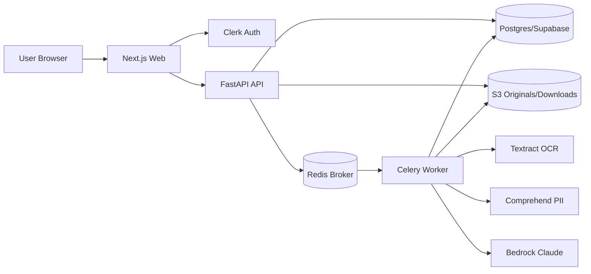

# RedacTLDR Architecture

This document describes the intended production architecture and the currently implemented runtime boundaries.

## System Goals

- privacy-preserving document intelligence
- website-first SaaS UX
- async heavy processing
- policy-driven behavior for redaction and AI usage
- security and observability as built-in concerns

## High-Level Components

## Runtime Responsibilities

### Web (`apps/web`)

- user-facing dashboard and workflows
- protected routes and token minting through Clerk
- React Query state management for API-backed workflows

### API (`services/api`)

- auth verification
- ownership and policy checks
- orchestration of document lifecycle state
- presigned URL issuance
- task enqueueing
- read/write contracts for UI

### Worker (`services/worker`)

- OCR extraction
- PII detection
- redaction export generation
- AI summary generation
- status updates and failure handling

## Data Ownership and Authorization

- primary ownership boundary is `owner_user_id`/user subject in API checks
- hybrid strategy:
  - backend authorization checks for request-time enforcement
  - selective RLS on sensitive tables as platform matures

## Privacy Model

- workspace policy controls:
  - safe mode masking behavior
  - OCR storage behavior
  - export constraints
- redaction export must remove underlying text, not only draw overlays
- logs should avoid raw PII whenever possible

## Security Controls (Planned and Incremental)

- Clerk JWT verification via JWKS cache
- short-lived presigned URLs
- KMS encryption strategy for document storage
- least-privilege IAM roles
- audit logging for sensitive operations

## Observability

- OpenTelemetry instrumentation in API and worker
- trace and metrics coverage for:
  - API latency/error rates
  - queue/job latency and failures
  - OCR, detection, export, summary durations

## Deployment Strategy

- primary: ECS Fargate
- optional later: Kubernetes/Helm path

## Milestone Alignment

For execution order and acceptance criteria see:

- `docs/EXECUTION_PLAN.md`
- `docs/MILESTONES_DETAILED.md`
