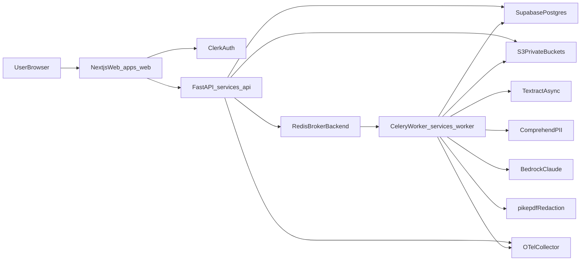

# redactldr Architecture

## Goals

- Privacy-preserving PDF intelligence with true redaction.
- Website-first UX with secure upload, review, export, and safe summaries.
- Strong operational posture: observability, security scanning, reproducible deploys.

## System Components

## Data Model (v1)

Core entities:

- `documents`: uploaded source metadata and lifecycle state.
- `detections`: proposed PII findings with page/block/bbox references.
- `manual_redactions`: user review actions and custom redactions.
- `exports`: generated redacted PDF artifacts.
- `summaries`: structured JSON plus markdown outputs.
- `audit_logs`: immutable event trail for key security and business actions.

## Processing Flow

1. Web requests presigned URL for upload.
2. Browser uploads PDF directly to private S3 bucket.
3. API stores document metadata and queues `detect_job`.
4. Worker runs OCR + PII detection and persists detections.
5. User reviews detections, adds custom redactions, and saves decisions.
6. API queues `export_job` for true redaction output.
7. API queues `summary_job` with masked text in safe mode.
8. Export and summary are stored and exposed via authorized APIs.

## Privacy Rules

- Safe mode controls whether raw or masked text is sent to LLM.
- Typed placeholders (`[NAME]`, `[EMAIL]`, etc.) are stable per document.
- 7-day default retention policy is enforced by cleanup tasks.
- Secrets are loaded from environment variables only.

## Observability

- OpenTelemetry traces/metrics in API and workers.
- Collector in local compose to centralize telemetry.
- Core metrics:
  - API latency and error rates
  - queue depth and job latency
  - failure rates per stage
  - LLM token usage metadata
