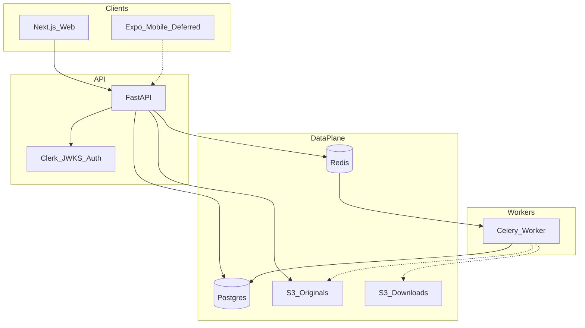
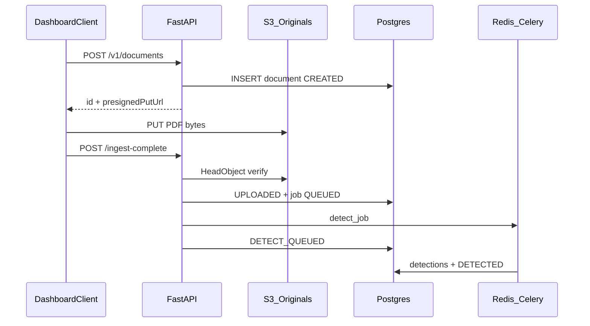
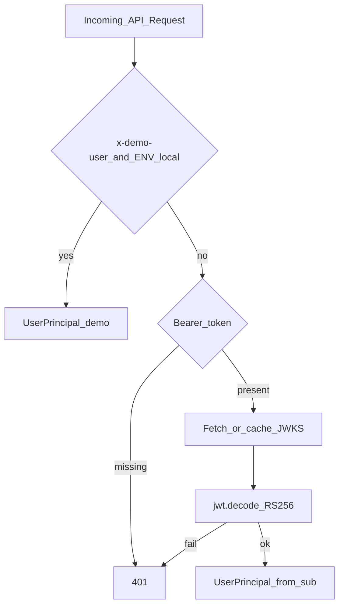

# 02 — Architecture and Implementation

> Companions: [Master Overview](01_TLDR_MASTER_OVERVIEW.md) · [Features](03_TLDR_FEATURES_STATUS_AND_ROADMAP.md) · [Resume](04_TLDR_RESUME_AND_INTERVIEW_GUIDE.md) · [Handoff](05_TLDR_CONTEXT_HANDOFF.md)

**Note:** This project uses **FastAPI + SQLAlchemy**, not Django. Template “Django application” tables are mapped to FastAPI modules below.

---

## 1. System Architecture

### Text diagram

```
Browser (Next.js apps/web)
  ├─ Clerk (sign-in/up, session, JWT template)  [optional; local demo skips]
  └─ HTTPS → FastAPI (services/api)
        ├─ Auth: JWKS verify / x-demo-user
        ├─ Postgres (documents, detections, jobs, …)
        ├─ S3 presign → browser PUT originals bucket
        ├─ Redis → Celery (services/worker)
        │     ├─ detect_job (stub regex)
        │     ├─ export_job (pikepdf rewrite stub)
        │     └─ summary_job (placeholder payload)
        └─ Optional OTLP → otel-collector (compose profile)
```

### Component interaction



### Request flow (authenticated document list)

1. User opens `/dashboard` → Clerk `auth.protect` (if publishable key set) or demo mode.  
2. Server component obtains JWT via `getToken({ template: CLERK_JWT_TEMPLATE })`.  
3. `DashboardClient` calls `GET /v1/documents` with `Authorization: Bearer` or `x-demo-user`.  
4. API resolves principal, filters `Document.owner_user_id == user_id` and `deleted_at IS NULL`.  
5. JSON list rendered; React Query refetches every 5s if any document is in an active status.

### Data flow (upload)



### Authentication flow



### Media-upload flow

See sequence diagram above. Key design: **API never proxies PDF bytes**; clients upload directly to S3 with short-TTL SigV4 presigned URLs (`s3.py` `presign_put`, TTL clamped 60–3600s).

### Public-page rendering flow

`/` is a static App Router page (server component) with product copy and links. No SSR of user documents on public routes. Metadata comes from root `layout.tsx` only.

### Administrative workflow

**Not present** — no admin dashboard, no staff moderation queue.

### AI-response flow (current)

```
POST /v1/documents/{id}/summaries
  → Summary row QUEUED + Job summary QUEUED
  → Celery summary_job
  → build_summary_payload() placeholder JSON
  → UPDATE summaries SET SUMMARIZED
GET .../summaries/latest returns stored payload
```

No streaming, SSE, WebSockets, or live Bedrock calls in the active path.

**Evidence**

* File: `services/worker/app/tasks.py`  
* Symbol: `summary_job`  
* Lines: ~231–299  
* Finding: Placeholder markdown explicitly says pending Bedrock integration  
* Status: prototype  
* Confidence: high  
* Resume relevance: medium (orchestration), none for “production LLM”  
* Ownership status: repository-level / sole author likely  

---

## 2. Backend Architecture

### Structure (not Django)

| Module area | Path | Role |
| ----------- | ---- | ---- |
| App entry | `services/api/app/main.py` | FastAPI app, CORS, startup, routers, health |
| Config | `config.py` | pydantic-settings style env |
| DB | `db.py` | engine, session, `Base` |
| Models | `models.py` | ORM |
| Schemas | `schemas.py` | Pydantic request/response |
| Enums | `enums.py` | modes + statuses |
| Auth | `auth.py` | `get_current_user` |
| Routes | `routes/auth.py`, `documents.py`, `audit.py` | HTTP |
| Services | `services/s3.py`, `audit.py`, `masking.py`, `validation.py`, `summary_schema.py` | helpers |
| Celery client | `celery_client.py` | enqueue from API |
| Telemetry | `telemetry.py` | optional OTel |
| Worker | `services/worker/app/{celery_app,tasks,redaction,summary,geometry,config}.py` | async |

### Backend “applications” table (FastAPI domains)

| Application | Purpose | Models | Endpoints | Services | Dependencies | Status | Evidence |
| ----------- | ------- | ------ | --------- | -------- | ------------ | ------ | -------- |
| api.auth | Identity | — | `/v1/auth/me` | JWKS | jose, httpx, Clerk | Implemented | `auth.py`, `routes/auth.py` |
| api.documents | Lifecycle orchestration | Document + children | `/v1/documents/*` | s3, audit, celery | SQLAlchemy, boto3, Celery | Partial (stubs downstream) | `routes/documents.py` |
| api.audit | Event read | AuditLog | `/v1/audit` | — | SQLAlchemy | Implemented | `routes/audit.py` |
| worker.tasks | Async pipeline | updates via SQL | Celery names | redaction, summary | Celery, SQLAlchemy, pikepdf | Prototype logic | `tasks.py` |

---

## 3. API Inventory

### Complete endpoint table

| Method | Route | Purpose | Auth | Permission | Input | Output | Model/Service | Frontend Usage | Tests | Status | Evidence |
| ------ | ----- | ------- | ---- | ---------- | ----- | ------ | ------------- | -------------- | ----- | ------ | -------- |
| GET | `/v1/health` | Liveness | None | Public | — | `{status,version}` | settings | Mobile health; smoke | None direct | Implemented | `main.py` L69–72 |
| GET | `/v1/auth/me` | Who am I | CurrentUser | Authenticated | — | principal | auth | Not used by web client listed | `test_auth` (demo path) | Implemented | `routes/auth.py` |
| GET | `/v1/audit` | List own audit events | CurrentUser | Own user_id | limit/offset | event list | AuditLog | None in web | None | Implemented | `audit.py` L12–36 |
| POST | `/v1/documents` | Create + presign | CurrentUser | Owner self | CreateDocumentRequest | id, s3Key, URL, status | Document, s3 | `createDocument` | None | Implemented | `documents.py` L86–138 |
| GET | `/v1/documents` | List | CurrentUser | Own | limit/offset | DocumentOut[] | Document | `listDocuments` | None | Implemented | L141–157 |
| GET | `/v1/documents/{id}` | Get one | CurrentUser | Owner | id | DocumentOut | Document | None in web client | None | Implemented | L160–163 |
| POST | `/v1/documents/{id}/ingest-complete` | Finish upload | CurrentUser | Owner | id | id,status | S3 head, Job, Celery | `completeIngest` | None | Implemented | L231–234 |
| POST | `/v1/documents/{id}/ingestDone` | Alias | CurrentUser | Owner | id | same | same | Mobile uses this | None | Implemented | L237–240 |
| GET | `/v1/documents/{id}/detections` | List detections | CurrentUser | Owner | id | DetectionOut[] | Detection | None | None | Implemented API | L243–252 |
| POST | `/v1/documents/{id}/redactions` | Add manual redaction | CurrentUser | Owner | ManualRedactionUpsert | id,status | ManualRedaction | None | None | Implemented API | L255–288 |
| POST | `/v1/documents/{id}/export` | Queue export | CurrentUser | Owner | ExportRequest | ExportOut | ExportArtifact, Celery | None | None | Partial | L291–336 |
| GET | `/v1/documents/{id}/export` | Get export | CurrentUser | Owner | id | ExportOut | ExportArtifact, presign | None | None | Partial | L339–349 |
| POST | `/v1/documents/{id}/summaries` | Queue summary | CurrentUser | Owner | SummaryRequest | id,status | Summary, Celery | None | None | Partial | L352–389 |
| GET | `/v1/documents/{id}/summaries/latest` | Latest summary | CurrentUser | Owner | id | SummaryOut | Summary | None | None | Partial | L392–406 |
| GET | `/v1/documents/{id}/review-state` | Review bundle | CurrentUser | Owner | id | detections+redactions | multi | None | None | Partial | L409–460 |
| GET | `/v1/documents/modes/schema` | Mode field schema | CurrentUser* | Auth | — | mode→fields | static dict | None | summary validation related | Implemented | L463–513 |

\*All document routes use `CurrentUser` except health; `modes/schema` is under documents router and requires auth via dependency on sibling pattern—confirm: looking at code, `mode_schema` does **not** take `user=CurrentUser`, so it is **unauthenticated** if reached.  

**Evidence**

* File: `services/api/app/routes/documents.py`  
* Symbol: `mode_schema`  
* Lines: 463–513  
* Finding: No `CurrentUser` dependency on mode schema endpoint  
* Status: implemented but public-within-API  
* Confidence: high  
* Resume relevance: low  
* Ownership: repository-level  

### Grouping

- **Authentication:** `/v1/auth/me`, health  
- **Document management:** create/list/get/ingest  
- **Media:** S3 presign (not a separate REST resource)  
- **Detections / redactions / review:** present API, no web UI  
- **Export / summaries / modes:** present API, stub workers  
- **Audit:** list  
- **CMS / SEO / messaging / directory / staff:** not present  

---

## 4. Frontend Architecture

| Topic | Detail | Evidence |
| ----- | ------ | -------- |
| Entry | Next.js App Router | `apps/web/app/layout.tsx` |
| Providers | React Query (+ Clerk when configured) | `components/providers.tsx` |
| Routing | `/`, `/dashboard`, `/sign-in`, `/sign-up` | `app/**/page.tsx` |
| State | React Query primary; Zustand dependency lightly used | dashboard-client |
| API client | `lib/api.ts` | create/list/ingest/upload only |
| Styling | Tailwind utility classes | components |
| Auth UX | Clerk components routes; demo banner | dashboard page |
| Review/export/summary UI | **Missing** | api.ts has no callers |
| A11y | Basic labels on form controls | dashboard-client L134–163 |
| SEO frontend | Root metadata only | layout.tsx L6–9 |

### Page inventory

| Page/Route | User | Purpose | Components | APIs | Data | Permissions | Status | Evidence |
| ---------- | ---- | ------- | ---------- | ---- | ---- | ----------- | ------ | -------- |
| `/` | Visitor | Landing | Link | — | Copy | Public | Implemented | `app/page.tsx` |
| `/dashboard` | Auth/demo | Upload + list | DashboardClient | documents CRUD subset | Documents | Clerk protect or open demo | Implemented | `dashboard/page.tsx` |
| `/sign-in/[[...sign-in]]` | Visitor | Clerk sign-in | Clerk | — | — | Public when Clerk on | Implemented | sign-in page |
| `/sign-up/[[...sign-up]]` | Visitor | Clerk sign-up | Clerk | — | — | Public when Clerk on | Implemented | sign-up page |

### Reusable components (meaningful)

| Component | Purpose | Status |
| --------- | ------- | ------ |
| `DashboardClient` | Upload form + document list + polling | Implemented |
| `Providers` | Query/Clerk providers | Implemented |
| `DocumentRow` | List row (local function) | Implemented |

Mobile: `frontend/mobile/App.tsx` — health + upload using `ingestDone`; **no auth headers**; may drift from API `mode` requirement — **prototype**.

---

## 5. Database Architecture

- **Engine:** PostgreSQL  
- **ORM:** SQLAlchemy 2.0 mapped columns  
- **Migrations:** Alembic (2 revisions)  
- **Local bootstrap:** `Base.metadata.create_all` when `ENVIRONMENT=local` (`main.py` L46–55)  
- **Non-local:** SELECT 1 only; schema via Alembic  

### Data dictionary

| Model/Table | Purpose | Important Fields | Relationships | Constraints | Used By | Evidence |
| ----------- | ------- | ---------------- | ------------- | ----------- | ------- | -------- |
| documents | Upload lifecycle | owner_user_id, s3_key, status, mode, safe_mode, deleted_at | children cascade | unique s3 keys | API + worker | `models.py` L23–57 |
| detections | PII candidates | entity_type, bbox JSONB, confidence, accepted | → document | FK | worker insert, API list | L60–78 |
| manual_redactions | User redactions ops | bbox/span, created_by | → document | FK | API POST | L81–99 |
| exports | Download artifacts | s3_key, status | → document | FK | API + worker update | L102–114 |
| summaries | AI payloads | json_payload, markdown, token_usage | → document | FK | API + worker | L117–132 |
| audit_logs | Event trail | event_type, payload | optional document_id | — | API write/read | L135–146 |
| jobs | Async units | job_type, status, attempts, result | → document | FK | API enqueue + worker | L149–177 |

### Behaviors

| Behavior | Implementation |
| -------- | -------------- |
| Create | API inserts Document on POST |
| Update | Status transitions API + worker SQL |
| Soft delete | `deleted_at` columns; list/get filter null |
| Ownership | `owner_user_id == principal` |
| Visibility | Private to owner; no public publish flag |
| RLS | ENABLE + deny `anon`/`authenticated` USING false (PostgREST lockdown) |
| Time zone | `datetime.utcnow` (naive UTC) |
| Seed | `scripts/seed_m3_demo.py` |

**Evidence**

* File: `alembic/versions/eb35da4c4c2e_m3_schema_expansion_jobs_rls.py`  
* Symbol: RLS policies `*_deny_anon_authenticated`  
* Lines: ~87–118  
* Finding: Restrictive deny for Supabase PostgREST roles; app DB role expected to bypass  
* Status: implemented  
* Confidence: high  
* Resume relevance: high  
* Ownership: verified personal (sole author repo) with WIP caveat  

---

## 6. Authentication and Authorization

| Topic | Finding |
| ----- | ------- |
| Mechanism | Clerk JWT (RS256) via JWKS; local header bypass |
| Session | Clerk-managed browser session; API is bearer JWT |
| Registration / login UI | Clerk hosted components routes |
| Password reset | Clerk (external); not custom |
| CSRF | API is bearer-token; Next uses Clerk middleware |
| CORS | Configurable origins; local defaults localhost:3000 |
| Token refresh | Clerk client/session; API validates each request |
| Object authz | `_require_document` ownership + soft-delete |

### Permission matrix

| Role | Resource | View | Create | Edit | Delete | Approve | Publish | Administer | Evidence |
| ---- | -------- | ---- | ------ | ---- | ------ | ------- | ------- | ---------- | -------- |
| Demo/Clerk user | Own documents | Y | Y | status via jobs | soft-delete field unused in API | N | N | N | documents.py |
| Demo/Clerk user | Other users’ documents | N (404) | N | N | N | N | N | N | `_require_document` |
| Anonymous | API documents | N | N | N | N | N | N | N | 401 |
| Staff | — | — | — | — | — | — | — | — | Not present |

Frontend-only restrictions: Clerk route protect for `/dashboard`. Backend still enforces JWT/demo on API—**aligned** for document routes.

---

## 7. Media and File Handling

| Topic | Detail | Status |
| ----- | ------ | ------ |
| Types | PDF only (`application/pdf`) | Implemented |
| Size | `max_upload_size_bytes` (default 20MB in config) | Implemented |
| Storage | AWS S3 originals + downloads buckets | Implemented |
| Naming | `originals/{user_id}/{doc_id}/{ts}-{safeFilename}` | Implemented |
| Presign | PUT without Content-Type binding; GET downloads | Implemented |
| Ingest verify | HeadObject length + content-type checks | Implemented |
| Thumbnails / optimization | Not present | — |
| True redact write to S3 | Export job updates DB key but does not upload bytes | Missing / stub |
| Orphan cleanup | Not present | — |
| Logging safety | `redact_presigned_url_for_logging` strips query | Implemented |

---

## 8. Search, Filtering, Directory

**Not present** as a product directory. Document list is owner-scoped pagination (`limit`/`offset`), newest first—not a search engine.

---

## 9. CMS and Content Management

**Not present.** No Django Admin CMS, no third-party CMS, no draft/publish content models for marketing pages beyond static React.

---

## 10. SEO Implementation

| SEO Feature | Implementation | Pages | Evidence | Test/Audit | Status | Resume Relevance |
| ----------- | -------------- | ----- | -------- | ---------- | ------ | ---------------- |
| Page title / description | Static Metadata export | All via layout | `layout.tsx` L6–9 | None | Implemented (minimal) | Low |
| Dynamic metadata | — | — | — | — | Not present | Do not claim |
| Canonical URLs | — | — | — | — | Not present | Do not claim |
| robots.txt | — | — | Search found none | — | Not present | Do not claim |
| sitemap.xml | — | — | Search found none | — | Not present | Do not claim |
| Open Graph / Twitter | — | — | — | — | Not present | Do not claim |
| Structured data | — | — | — | — | Not present | Do not claim |
| Lighthouse / SEO score artifacts | — | — | — | — | Not present | Do not claim |

**No** before/after SEO metrics exist in the repository. Do not claim SEO score improvements.

---

## 11. AI, Chat, and Streaming

| Capability | Status |
| ---------- | ------ |
| LLM provider wiring | Config `BEDROCK_MODEL_ID` only |
| LangChain dependency | Present in requirements; **no active orchestration path found in worker summary** |
| Chat UI / SSE / WebSockets | Not present |
| Markdown summary field | Stored string from stub |
| react-markdown | Not found in web app usage for summaries |
| RAG / embeddings / vectors | Not present |
| Masking helper | `mask_text` deterministic placeholders — unit tested; not clearly wired into live detect path |

**Verdict:** AI is **planned + stubbed**, not production-connected.

---

## 12. External Integrations

| Service | Purpose | Method | Files | Data | Security | Status | Resume Relevance |
| ------- | ------- | ------ | ----- | ---- | -------- | ------ | ---------------- |
| Clerk | AuthN | JWT JWKS + Next SDK | auth.py, middleware, dashboard | user sub, email claim | Audience/issuer checks | Implemented | High |
| AWS S3 | Object storage | boto3 presign/head | s3.py | PDF objects | Presigned TTL, private buckets (terraform blocks public) | Implemented | High |
| Redis | Broker/backend | Celery URLs | config, compose | job messages | Network local/compose | Implemented | High |
| Postgres / Supabase | Persistence | SQLAlchemy, Alembic | models, alembic | document graph | RLS deny anon/auth | Implemented | High |
| OTLP collector | Telemetry | optional env | telemetry.py | spans | Dev profile | Partial | Medium |
| AWS Textract / Comprehend / Bedrock | Intelligence | Planned | docs, config model id | — | — | Planned | Interview only / Do not claim as built |
| Cosign | Image signing | CI job placeholder | security.yml | — | — | Prototype placeholder | Do not claim |

---

## 13. Validation, Reliability, Error Handling

| Rule | Layer | Purpose | Failure | User Feedback | Tests | Evidence |
| ---- | ----- | ------- | ------- | ------------- | ----- | -------- |
| PDF content type | API s3 + create | Block non-PDF | ValueError→400 | Error string | None route | `s3.py` L69–74 |
| Max upload size | API | Cap bytes | 400 | Error | None | config + s3 |
| Filename required | API | Non-empty | 400 | detail | None | documents.py L97–99 |
| Object exists on ingest | API HeadObject | Prevent false queue | 409 | detail | None | L183–185 |
| Content-type mismatch | API | Integrity | 409 | detail | None | L186–191 |
| JWT invalid | Auth | AuthN | 401 | detail | demo test only | auth.py |
| Enqueue failure | API | Availability | 503 | detail | None | documents.py |
| Celery retries | Worker | Transient faults | retry then FAILED | status field | None | tasks.py max_retries=3 |
| Bbox clamp | Worker | Geometry safety | clamp | — | test_geometry | redaction.py |
| Summary schema keys | validation module | Mode contracts | validation helpers | — | test_summary_validation | services |

No global React error boundary observed beyond query error UI. No idempotency keys beyond ingest early-return on advanced statuses.

---

## 14. Testing

| Feature | Test Files | Type | Covered | Missing | Status | Evidence |
| ------- | ---------- | ---- | ------- | ------- | ------ | -------- |
| Demo auth | `test_auth.py` | Unit | x-demo-user | Clerk JWT, JWKS failure | Thin | api/tests |
| Masking | `test_masking.py` | Unit | placeholders | Integration with detect | Thin | |
| Summary validation | `test_summary_validation.py` | Unit | required keys | Bedrock | Thin | |
| Geometry | `test_geometry.py` | Unit | span/bbox | PDF redact correctness | Thin | |
| API routes | — | — | — | All HTTP paths | Missing | |
| Frontend | — | — | — | Components/e2e | Missing | |
| S3/Celery integration | — | — | — | Full pipeline | Missing | |

CI executes `pytest` (no coverage percentage artifact found in repo). **Do not invent coverage %.**

---

## 15. Security and Privacy

| Control | Classification | Evidence |
| ------- | -------------- | -------- |
| Secrets via env / examples | Configuration-dependent | `.env.example` placeholders |
| JWT signature verify | Implemented protection | auth.py |
| Local demo auth | Configuration-dependent (local only) | auth.py L68–70 |
| Ownership checks | Implemented | `_require_document` |
| CORS allowlist | Configuration-dependent | config + middleware |
| SQLAlchemy parameterized SQL | Implemented | ORM + bound text |
| Presigned URL TTL | Implemented | s3.py |
| Upload type/size limits | Implemented | s3.py |
| RLS deny PostgREST roles | Implemented | migration |
| Rate limiting | Missing protection | — |
| True redaction of PDF content | Missing / prototype | redaction.py |
| Dependency scanning | Implemented in CI | Trivy/Syft |
| Debug in production | Config-dependent | environment setting |
| Sensitive URL logging helper | Implemented | `redact_presigned_url_for_logging` |
| Markdown XSS (summary UI) | N/A (no summary renderer yet) | — |

No exploitation was attempted in this audit.

---

## 16. Performance and Scalability

| Topic | Finding |
| ----- | ------- |
| Pagination | limit/offset on documents and audit |
| Indexes | owner_user_id, deleted_at, FKs, job status fields |
| N+1 | Review-state loads detections+redactions explicitly (2 queries) |
| Caching | JWKS 10-minute in-process cache |
| Async heavy work | Celery offload |
| Image optimization | N/A |
| Claimed “high scale” | **Unsupported** — no load tests |

---

## 17. Deployment and DevOps

| Capability | Support | Evidence |
| ---------- | ------- | -------- |
| Local Compose | Yes | `ops/compose/docker-compose.yml`, `scripts/dev-up.sh` |
| Container images | Yes | api/worker Dockerfiles; CI builds |
| Automated tests in CI | Yes | pytest + web quality gates |
| Security scanning | Yes | Syft + Trivy SARIF |
| Image signing | Placeholder only | security.yml sign-images |
| Terraform apply-ready prod | Partial | S3/ECR/ECS cluster only |
| ECS services/tasks | Missing | comments in terraform |
| Helm optional path | Scaffold | `ops/k8s/helm` |
| Staging/prod envs documented | Partial | playbooks; no live prod proof |
| Monitoring | OTel optional | compose profile |

---

## 18. Local Setup and Code-Reading Guide

### Prerequisites

Docker Desktop, Docker Compose; optional AWS CLI for S3 CORS; optional Clerk keys.

### Environment (placeholders only)

See `.env.example` / `ops/compose/.env.example`: `DATABASE_URL`, `CELERY_*`, `S3_BUCKET_*`, `AWS_*`, `CLERK_*`, `NEXT_PUBLIC_*`, `BEDROCK_MODEL_ID`. **Do not commit real secrets.**

### Commands

```bash
bash scripts/dev-up.sh          # start stack
# Web http://localhost:3000  API http://localhost:8000/v1/health
bash scripts/dev-down.sh        # stop
pytest                          # from repo root per pytest.ini
npm run web:lint && npm run web:typecheck && npm run web:build
```

### Recommended reading order

1. `README.md`  
2. `apps/web/app/dashboard/page.tsx` + `dashboard-client.tsx` + `lib/api.ts`  
3. `services/api/app/auth.py` + `routes/documents.py` + `services/s3.py`  
4. `models.py` + Alembic versions  
5. `services/worker/app/tasks.py`  
6. `ops/compose/docker-compose.yml` + `.github/workflows/*`  
7. `docs/MILESTONE_STATUS.json` + this `docs/resume/` set  

### Common setup problems

- S3 CORS on browser PUT → `scripts/apply-s3-cors.sh`  
- Missing `CLERK_JWT_TEMPLATE` when Clerk enabled → dashboard throws  
- Worker/API DB URL mismatch  

---

*Feature-level status catalog: [03_TLDR_FEATURES_STATUS_AND_ROADMAP.md](03_TLDR_FEATURES_STATUS_AND_ROADMAP.md).*
